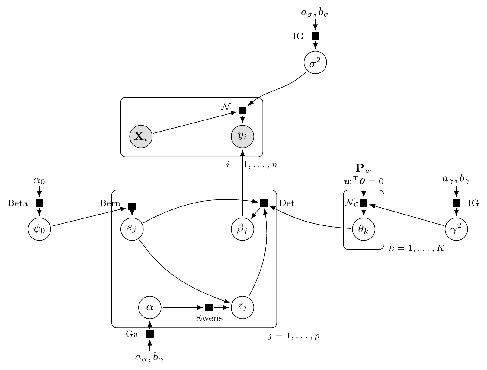

# BRACE: Bayesian Regression with Agglomerated Compositional Effects

Code accompanying the paper **"Flexible aggregation of compositional predictors with shared effects for microbiome association analysis"**.

**Authors:** Satabdi Saha, Liangliang Zhang, Michele Guindani, Kim-Anh Do, Christine B. Peterson

BRACE is a Bayesian high-dimensional compositional regression model for microbiome association analysis. A spike-and-cluster prior combines Bernoulli activity indicators, an Ewens exchangeable partition prior on the active predictors, and a projection-based constrained Gaussian prior on the cluster effects that enforces the log-contrast (sum-to-zero) constraint. BRACE performs variable selection and groups taxa with similar effects on the outcome.

## Model

<p align="center">
  
</p>

Plate diagram for BRACE. The model combines three components: (i) Bernoulli spike indicators $s_j$ for variable selection, (ii) an Ewens exchangeable partition prior on the active indices for data-adaptive feature aggregation, and (iii) a projection-based constrained Gaussian prior on the cluster effects $\boldsymbol\theta$ that enforces the compositional constraint $\mathbf{1}^\top\boldsymbol\beta = 0$. Shaded circles are observed, open circles are latent, and filled squares are factor nodes.

## Repository structure

```
.
├── toy_example.R                       Simulate data and run BRACE
├── Required Functions/                 BRACE sampler and data-generation functions
├── images/plate_diagram.png            Plate diagram shown above
├── Reproduce_Results/
│   ├── Reproduce_Figures_1_and_3.Rmd   Recreates Figures 1 and 3 (ORIGINS data)
│   ├── Reproduce_Figures_1_and_3.pdf   Knitted output
│   ├── Demmer_phyloseq_processed.rds
│   ├── continuous_spearman_screening_relative_abundance.csv
│   └── Pseudocount_0.5_postSALSO_K7_results_2chain.Rdata
└── archived/                           Earlier versions of this repository
```

## Toy example

`toy_example.R` simulates compositional data (n = 300, p = 100, AR(1) correlation with rho = 0.5, SNR = 1, 34 nonzero coefficients in 8 clusters that sum to zero), splits it 80/20 into training and test sets, runs the BRACE Gibbs sampler on the training set, and computes the performance metrics used in the paper: prediction error (PE), L2 loss, true and false positives and false negatives, coverage and width of the 95% posterior predictive intervals, the adjusted Rand index (ARI) between the SALSO partition and the true clusters, and the number of clusters. From the repository root:

```r
install.packages(c("MASS", "MCMCpack", "salso"))
source("toy_example.R")
```

With the default settings this is a quick illustration: one simulated dataset under the AR(1) design of Supplementary Section S5.2 and a short chain of 300 iterations (about 3–4 minutes), so its metrics are comparable to, but not identical with, those in the paper.

All settings are at the top of the script. To run the full simulation design of the paper, set:

| Setting | Full design |
|---|---|
| `design` | `"block"` for Scenario 1 (Section 3.7; Tables 1 and 3), or `"ar1"` for Supplementary Section S5.2 |
| `p` | 100, 300 or 1000 |
| `snr` | 1, 5 or 10 |
| `n_rep` | 30 (2 or more also gives the cross-replicate ARI) |
| `nburn`, `nsamp` | 5000 and 3000 (8000 iterations, first 5000 discarded) |

A full setting at p = 100 takes several hours; larger p takes longer.

## Figures 1 and 3 (ORIGINS oral microbiome data)

`Reproduce_Results/Reproduce_Figures_1_and_3.Rmd` regenerates Figures 1 and 3 from the saved BRACE posterior output; the MCMC is not re-run. Knit it from the `Reproduce_Results/` folder (about 20 seconds). The figures are also written as PDF files to `Reproduce_Results/Figures/`.

```r
install.packages(c("ape", "dplyr", "ggplot2", "ggtext", "patchwork", "reshape2",
                   "rmarkdown", "stringr", "tibble"))
install.packages("BiocManager")
BiocManager::install(c("phyloseq", "ggtree"))
rmarkdown::render("Reproduce_Results/Reproduce_Figures_1_and_3.Rmd")
```

Panel A of Figure 3 summarises the mean and standard deviation over 30 random train/test splits for each method; these summary values are entered directly in the Rmd.

## Archived material

`archived/` holds earlier versions of this repository for reference: `2024-11_GitHub/` is the version posted with the original submission and `2024-04_local_clone/` an earlier working copy.
